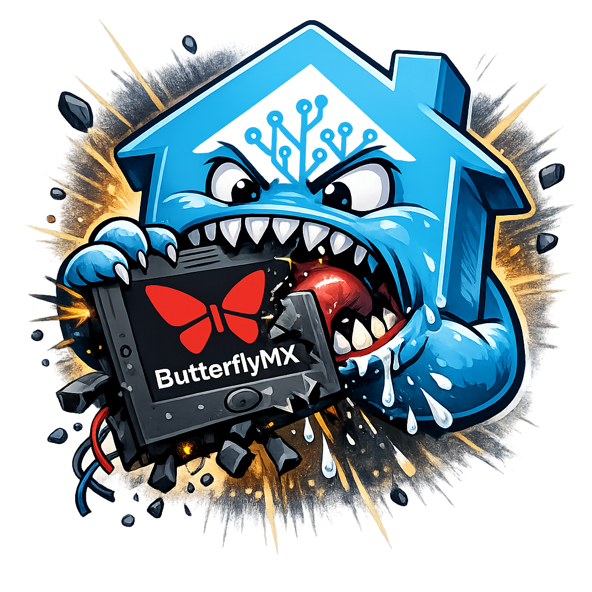

# ButterflyMX Home Assistant Integration


This integration allows you to control your ButterflyMX access points (doors) and view message/call history from Home Assistant.

> [!WARNING]
> **For educational and personal use only.** This integration is an unofficial, independent project. It is not affiliated with, endorsed by, or supported by ButterflyMX. It works by using the same private API as the official mobile app, which can change or stop working at any time without notice.
>
> - Use it only with your own account and only for doors you are authorized to access.
> - You are responsible for complying with ButterflyMX's Terms of Service and your building's policies.
> - This software is provided "as is", without warranty of any kind. The authors are not liable for any damages, account suspensions, or security issues resulting from its use.

## Installation

Requires Home Assistant 2026.3 or newer.

### HACS (recommended)
1. In HACS, open the menu (⋮) > **Custom repositories**.
2. Add `https://github.com/Jxck-S/butterflymx-home-assistant` with category **Integration**.
3. Search for **ButterflyMX** in HACS and download it.
4. Restart Home Assistant.

### Manual
1. Copy `custom_components/butterflymx` into your Home Assistant `config/custom_components/` directory.
2. Restart Home Assistant.

Home Assistant installs the [butterflymx-client](https://github.com/Jxck-S/butterflymx-client) library automatically.

### Setup
1. Go to **Settings > Devices & Services**.
2. Click **Add Integration** and search for "ButterflyMX".
3. Enter your ButterflyMX email and password.

## Entities

Each ButterflyMX unit (tenant) shows up as a device with these entities:

*   **Locks**: One per door. **Unlock** opens the door. It shows as unlocked for 10 seconds, then locked again, because the doors re-lock themselves. Repeat unlocks within 20 seconds are ignored. A door that ButterflyMX reports as offline shows as unavailable.
*   **Sensors**:
    *   **Last Message**: The most recent text message. Attributes include visitor, source, timestamp and image URL.
    *   **Last Call**: The device and status of the most recent intercom call. Attributes include type, timestamp and image URL.
    *   **Last Access**: The door and type of the most recent door release. Attributes include method, device and timestamp.
    *   **Last Message Time / Last Call Time / Last Access Time**: When the latest event actually happened, according to ButterflyMX. Shown as "5 minutes ago" and usable in automations.
*   **Images**: Snapshots from the latest call, message and door release. Each image's time is when the event happened, not when Home Assistant fetched it.
*   **Intercom Call** (event, doorbell): Fires a `ring` event once for each new intercom call, with `call_id`, `status`, `type`, `device`, `logged_at` and `image_url`. Use it to trigger a phone notification. Each call rings at most once, including after a restart or a failed poll. A call older than 3 minutes — already in the history on first install, or found only after a long outage — does not ring. A failed poll leaves this entity as it is, so the previous ring does not come back looking like a new one; the sensors and locks still show unavailable. Two new calls between refreshes fire two events.

Data is refreshed every 30 seconds, with a single request per unit (ButterflyMX allows 350 requests a minute). A new call can take up to about 30 seconds to show up: ButterflyMX doesn't offer resident accounts a live feed of new calls, only push notifications to its own app.

### Instant call alerts (Home Assistant Cloud)

If Home Assistant Cloud (Nabu Casa) is logged in, the integration also sets up a ButterflyMX webhook so the **Intercom Call** event fires within seconds of a buzz:

1. It registers a Home Assistant webhook with a random ID and gets a `hooks.nabu.casa` cloudhook URL for it.
2. It creates one ButterflyMX tenant integration (`POST /v4/tenants/{tenant}/integrations`, binding `call` / `create`) that posts to that URL. If one already points there, it is reused.
3. ButterflyMX doesn't sign deliveries, so the integration carries a random secret in an `X-Webhook-Secret` header. Requests without it are rejected with 401.

The 30-second refresh keeps running as a fallback, and each call fires only once whichever way it arrives. Deleting the integration from Home Assistant deletes the ButterflyMX webhook and the cloudhook. Without Home Assistant Cloud nothing changes: calls are found by the 30-second refresh.

## Troubleshooting

*   **Changed your ButterflyMX password?** Home Assistant shows a repair to re-enter it under **Settings > Devices & Services**.
*   **ButterflyMX unreachable?** Sensors, locks and images show as unavailable and Home Assistant keeps retrying. The intercom call event stays on its last ring so that blip doesn't notify you again.
*   **Debug logs:** add this to `configuration.yaml`:
    ```yaml
    logger:
      logs:
        custom_components.butterflymx: debug
        butterflymx: debug
    ```

## Upgrading from 1.x

Version 2.0 stores login tokens in the integration's config entry instead of a separate file. The old `.storage/butterflymx_tokens_*.json` file is deleted automatically. After upgrading, the integration logs in once with your saved email and password. Entity IDs stay the same.

Version 2.1 uses Home Assistant's standard entity naming: names are now "Unit 101 Last Call" instead of "Last Call (Unit 101)". Existing entity IDs don't change. New installs get IDs like `sensor.unit_101_last_call`.

## Development

Tests run inside a real Home Assistant test instance with the ButterflyMX client mocked:

```bash
pip install -r requirements_test.txt
ruff check .
pytest
```

## License

[MIT](LICENSE). See the disclaimer at the top: this is an unofficial project, not affiliated with ButterflyMX.
